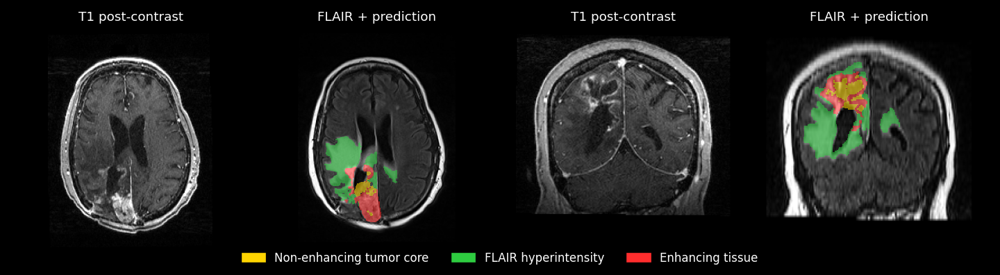

# MIST Glioma

[](https://colab.research.google.com/github/mist-medical/mist-glioma/blob/main/examples/demo_colab.ipynb)
[](https://huggingface.co/mist-medical/mist-glioma-brats2025)
[](https://arxiv.org/abs/2507.19626)
[](https://github.com/mist-medical/mist-glioma/actions/workflows/tests.yml)
[](https://github.com/mist-medical/mist-glioma/blob/main/LICENSE)

**Raw brain MRI to glioma segmentation in one command.**

MIST Glioma takes raw, unprocessed T1, T2, contrast-enhanced T1, and FLAIR images
in DICOM or NIfTI format. It returns a tumor and resection cavity segmentation in
the native space of the contrast-enhanced T1 image.

- **End to end.** It handles registration, brain extraction, and inference, so you
  do not need to preprocess anything first.
- **Third place at BraTS 2025.** The model placed third in the adult glioma task of
  the [BraTS-Lighthouse 2025 Challenge](https://www.synapse.org/Synapse:syn64153130/wiki/633062).
- **Pre- and post-operative.** It segments tumor subregions and the resection cavity.
- **Small.** Each of the five models has fewer than 1 million parameters.



*MIST Glioma's output on public case UPENN-GBM-00622, from raw DICOM input. Images
are from the [UPENN-GBM collection](https://doi.org/10.7937/TCIA.709X-DN49)
(CC BY 4.0).*

> **Research use only.** MIST Glioma is not a medical device. Do not use it for
> diagnosis, treatment planning, or other clinical decisions.

## Quickstart

Try it on a free GPU in
[Colab](https://colab.research.google.com/github/mist-medical/mist-glioma/blob/main/examples/demo_colab.ipynb),
or install it with Python 3.10 or newer:

```bash
python -m pip install mist-glioma
```

Then run it on all four images from one subject:

```bash
mist_glioma \
    --t1 /path/to/t1 \
    --t2 /path/to/t2 \
    --tc /path/to/t1ce \
    --fl /path/to/flair \
    --output /path/to/output \
    --device cuda
```

Each input can be a NIfTI file or a folder containing one DICOM series, and you can
mix the two. The output folder contains:

- `tumor_rc_mask.nii.gz`: multiclass tumor and resection cavity segmentation
- `brain_mask.nii.gz`: brain mask

Weights download automatically on first use. CPU inference is available with
`--device cpu`, although we recommend a GPU.

### Segmentation labels

| Value | Region |
| ---: | :--- |
| 0 | Background |
| 1 | Non-enhancing tumor core (NETC) |
| 2 | Surrounding non-enhancing FLAIR hyperintensity (SNFH) |
| 3 | Enhancing tissue (ET) |
| 4 | Resection cavity (RC) |

### Example data

To run the tool on the public case above (about 25 MB), from a clone of this
repository:

```bash
python examples/download_upenn_gbm_00622.py

mist_glioma \
    --t1 data/examples/UPENN-GBM-00622/t1 \
    --t2 data/examples/UPENN-GBM-00622/t2 \
    --tc data/examples/UPENN-GBM-00622/tc \
    --fl data/examples/UPENN-GBM-00622/fl \
    --output output/UPENN-GBM-00622 \
    --device cuda
```

These images are defaced but otherwise in their original acquisition space. If you
use them, cite the [collection](https://doi.org/10.7937/TCIA.709X-DN49) and follow
the TCIA Data Usage Policy. The script downloads them on demand, so they are not
part of this repository.

### Docker

The image includes the model weights, so it can run without network access:

```bash
docker run --rm --gpus all -v /path/to/data:/data mistmedical/mist-glioma \
    mist_glioma \
    --t1 /data/t1 \
    --t2 /data/t2 \
    --tc /data/t1ce \
    --fl /data/flair \
    --output /data/output \
    --device cuda \
    --offline
```

## Performance

These results are from [our paper](https://arxiv.org/abs/2507.19626), on the BraTS
2025 challenge validation set. Values are mean (standard deviation). The challenge
data was already preprocessed by the organizers, so these numbers do not measure
this tool's own registration and brain extraction on raw scans.

| Region | Dice | HD95 (mm) |
| :--- | ---: | ---: |
| NETC | 0.7114 (0.3556) | 42.902 (105.52) |
| SNFH | 0.8608 (0.1543) | 7.1704 (25.163) |
| ET | 0.7807 (0.2847) | 23.670 (77.327) |
| RC | 0.8445 (0.3058) | 25.010 (82.263) |
| Tumor core | 0.7925 (0.2855) | 24.582 (77.193) |
| Whole tumor | 0.9219 (0.0867) | 5.9289 (18.755) |

## How it works

1. **Registration.** Greedy rigidly registers each image to the contrast-enhanced
   T1 and that image to the SRI24 atlas, with the settings of the
   [CaPTk](https://github.com/CBICA/CaPTk) BraTS pipeline. N4 bias field correction
   is used only to estimate these registrations, so the images keep their original
   intensities. Each image is resampled once.
2. **Brain extraction.** HD-BET creates a brain mask, which is applied to all four
   images.
3. **Segmentation.** MIST runs a five-fold ensemble of pocket nnU-Net models with
   test-time augmentation.
4. **Return to native space.** The masks move back to the original
   contrast-enhanced T1 grid.

The tool stops with an error if a DICOM folder holds several series, has missing,
repeated, or unevenly spaced slices, or uses gantry tilt or multi-frame files.
Convert those series to NIfTI first. Registration can vary slightly between runs,
so repeat runs on the same scan may not match voxel for voxel.

### Images already in BraTS format

If your images are already registered to the SRI24 atlas and skull-stripped, skip
this pipeline and run `mist_predict` from
[MIST](https://github.com/mist-medical/MIST) directly, with the
[BraTS 2025 weights](https://huggingface.co/mist-medical/mist-glioma-brats2025) and
[config](https://github.com/mist-medical/mist-glioma/blob/main/mist_glioma/configs/brats2025.json). List the images in your paths CSV in
the order `t1`, `t2`, `tc`, `fl`, because MIST assigns model channels by column
order.

### Postprocessing

Pass `--postprocess` to keep only the largest connected component of the tumor
(labels 1, 2, and 3 together) and of the resection cavity. This step is off by
default and was not part of our BraTS 2025 entry, which used no postprocessing. It
removes all but the largest lesion in multifocal disease.

### Model weights

Weights are hosted on
[Hugging Face](https://huggingface.co/mist-medical/mist-glioma-brats2025) and stored
in the standard Hugging Face cache. Set `HF_HOME` to choose a different location, or
pass `--offline` to use cached weights without network access. HD-BET manages its
own weights.

To bypass Hugging Face, set `MIST_GLIOMA_MODELS_DIR` to a folder with this layout:

```text
models/
└── brats2025/
    ├── fold_0.pt
    ├── fold_1.pt
    ├── fold_2.pt
    ├── fold_3.pt
    └── fold_4.pt
```

## Citation

If you use MIST Glioma in your work, please cite:

```bibtex
@inproceedings{celaya2025pre,
  title={Pre-and Post-Treatment Glioma Segmentation with the Medical Imaging Segmentation Toolkit},
  author={Celaya, Adrian and Netherton, Tucker and Schellingerhout, Dawid and Chung, Caroline and Riviere, Beatrice and Fuentes, David},
  booktitle={International Conference on Medical Image Computing and Computer-Assisted Intervention},
  pages={28--37},
  year={2025},
  organization={Springer}
}
```

The pipeline bundles the SRI24 atlas. When using it, please cite:

```bibtex
@article{rohlfing2010sri24,
  title={The SRI24 multichannel atlas of normal adult human brain structure},
  author={Rohlfing, Torsten and Zahr, Natalie M and Sullivan, Edith V and Pfefferbaum, Adolf},
  journal={Human brain mapping},
  volume={31},
  number={5},
  pages={798--819},
  year={2010},
  publisher={Wiley Online Library}
}
```

MIST Glioma builds on [MIST](https://github.com/mist-medical/MIST),
[Greedy](https://github.com/pyushkevich/greedy),
[HD-BET](https://github.com/MIC-DKFZ/HD-BET),
[ANTsPy](https://github.com/ANTsX/ANTsPy), and
[SimpleITK](https://github.com/SimpleITK/SimpleITK).

## Development

```bash
python -m pip install -r requirements-dev.txt
pytest
```

The unit tests enforce at least 98% branch coverage.

## License

The source code and weights are licensed under the Apache License 2.0. The bundled
SRI24 atlas, at `mist_glioma/data/atlases/sri24/`, keeps its separate CC BY-SA 3.0
license.
